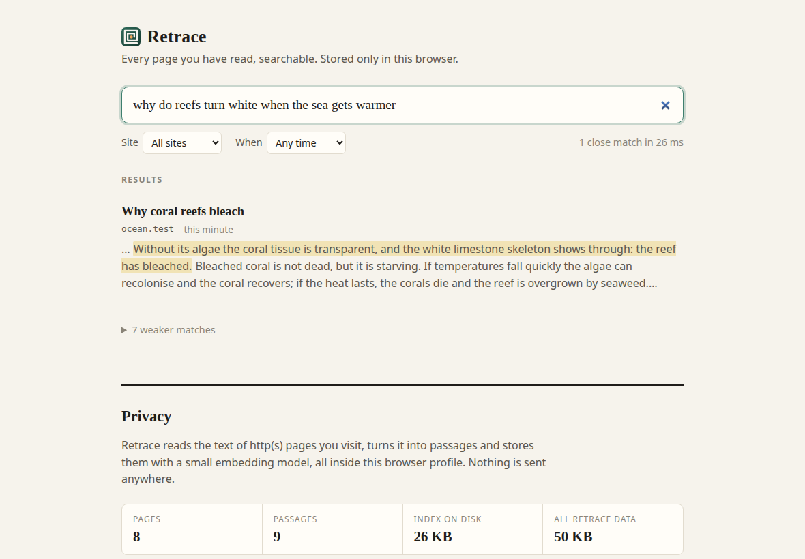

# Retrace

Semantic search over every page you have read. Stored only in your browser. No account, no server, no API key.



Retrace is a Chrome (Manifest V3) extension built on [ferrovec](../../README.md). It saves the readable text of the pages you visit, turns it into vectors with a small embedding model that ships inside the extension, and lets you search it by meaning. Search for "that article about why the build got slow" and it finds the page even if those words never appear in it.

Status: version 0.1.0. It is **not on the Chrome Web Store yet**. For now you load it unpacked (see below).

## Install

Retrace is not published to any store, so you build it and load it yourself.

```sh
# 1. build the ferrovec JS package
cd js && npm install && npm run build

# 2. build the extension
cd ../extensions/retrace
npm install
npm run fetch-model   # downloads the MiniLM model files once, to bundle them
npm run build         # writes extensions/retrace/dist
```

Then open `chrome://extensions`, turn on **Developer mode**, click **Load unpacked**, and choose `extensions/retrace/dist`. It needs Chrome 116 or newer.

The unpacked extension is 36 MiB (22 MB of that is the model, 13 MB the onnxruntime wasm).

## Use

- Type `rt`, a space, and what you remember into the address bar. For example: `rt tutorial about sqlite wal mode`.
- Or click the toolbar icon to open the search page.
- Results are grouped by page. Strong matches are shown first; weaker matches sit behind a disclosure.
- The privacy controls (below) are on the search page and in the extension's options.

Retrace only knows about pages you open after installing it. It does not import your browser history.

## What is captured

Retrace runs a content script on `http` and `https` pages. For each page it:

- extracts the readable text with Mozilla Readability;
- skips pages with fewer than about 400 characters of text;
- skips any page that has a password field;
- skips hosts on the blocklist;
- never runs in incognito windows (`"incognito": "not_allowed"`);
- splits the text into passages of about 200 words, at most 12 per page, and stores each passage with `{ url, title, host, visitedAt, chunk, of }`.

Not captured: incognito windows, `file:` and other non-http pages, and single-page-app navigations after the first load (the content script runs once per document load).

## Privacy controls

- **Pause and resume.** While paused the toolbar badge shows "off" and nothing is indexed.
- **Blocklist.** Editable, one pattern per line. The defaults cover banking and payments, webmail and messaging, health, and sign-in hosts. The list is deliberately broad; remove any entry you want indexed.
- **Forget this site**, **Forget the last hour** and **Delete everything**.
- **Stats** on what is stored, and **JSON export**.

### Forget really deletes

Removing a document from a search index usually only hides it. After a forget, Retrace calls ferrovec's `compact()`, which rebuilds the index and rewrites both snapshot slots and the write-ahead log. The end-to-end test then searches Retrace's on-disk store files and finds no trace of the forgotten text, passage id, URL or title.

Two caveats. The small per-URL bookkeeping record (URL and title) is deleted from IndexedDB, but its bytes can remain in IndexedDB's LevelDB log file until Chromium compacts it. And Chromium's own history and cache still know the page; that is outside Retrace.

## How it works

```
page -> content script (Readability, skip rules)
     -> service worker (queue, settings, omnibox)
     -> offscreen document: ferrovec worker + OPFS + wasm HNSW + MiniLM
     -> search page (grouped results)
```

- The **content script** extracts text and sends it to the service worker.
- The **service worker** applies the pause and blocklist rules, chunks the text, and queues the work. The queue holds 200 pages.
- The **store** lives in an offscreen document, because a service worker cannot host the ferrovec worker. It holds a ferrovec store (OPFS, crash-safe snapshots and write-ahead log, HNSW in wasm). It closes itself after 5 idle minutes and reopens on demand.
- The **model** (`Xenova/all-MiniLM-L6-v2`, q8) and the onnxruntime wasm are bundled in the extension. Nothing is fetched at runtime. The content security policy is `script-src 'self' 'wasm-unsafe-eval'`.
- **Permissions:** `storage`, `unlimitedStorage` and `offscreen`, plus the content script on `http` and `https` pages. There is no host permission beyond the content script and no network permission.

## Verification

Run in Playwright Chromium (new headless, `--load-extension`):

| Check | Result |
| --- | --- |
| End-to-end checks | 36 of 36 pass |
| Unit tests | 50 of 50 pass |
| 8 paraphrased queries over 8 fixture articles | right page first every time |
| Reopen after a browser restart | results persist |
| Blocked host, password page, paused state | not indexed |
| Network | every request the browser made went through a logging proxy, cross-checked with Chromium's NetLog: zero requests initiated by the extension |
| Forget | no trace of the forgotten text, id, URL or title in the on-disk store files |

The omnibox (`rt`) could not be driven in headless mode, so the automated test does not cover omnibox suggestions.

## Measured numbers

One Linux desktop, single-threaded wasm. Your machine will differ.

| What | Result |
| --- | --- |
| Indexing | about 110 ms per passage; about 1.1 s for a full 12-passage page (p50 1069 ms, p95 1403 ms); did not slow down as the store grew to 2,851 passages |
| Query at 2.8k passages | p50 19 ms, p95 26 ms |
| Cold start (store open and model load) | 290 to 560 ms |
| Disk | about 3.2 KB per passage per snapshot; steady state about two snapshots plus up to 4 MiB of log, so up to about 6.5 KB per passage; 2,851 passages (320 pages) is an 8.5 MB snapshot |
| Extension size | 36 MiB unpacked |

## Limits

- Indexing costs about 1 s of CPU per long page, in the background. The queue holds 200 pages and drops the oldest under heavy browsing.
- Memory use has not been measured.
- Tested up to about 2.9k passages. Every checkpoint rewrites a full snapshot, so cost grows with the store.
- Single-page-app navigations are not re-captured.
- What counts as a close match was measured on 35 real pages ([test/RELEVANCE.md](test/RELEVANCE.md)). On queries written after tuning: 84 % of close matches were the right page, 95 % of right pages were shown as close, and 7 of 10 questions about things not in the index showed nothing close. A question about a topic near something you read (the Sphinx, after reading about the Pyramids) can still show that page as close, and a loosely worded query for one of several similar pages (sibling chapters of a book) may show a sibling, or nothing close, with the page in the weaker list.
- Only the first 12 passages (about 2,600 words) of a page are indexed.
- Omnibox suggestions are not covered by the automated test.
- Not on the Chrome Web Store.

## Browser support

| Browser | Status |
| --- | --- |
| Chrome 116+ | Tested |
| Edge, Brave | Expected to work (same engine, nothing Chrome-only in the manifest). Not tested |
| Firefox | Port planned, not built |
| Safari | Not planned |

## Development

```sh
cd extensions/retrace
npm run typecheck   # tsc --noEmit
npm test            # unit tests
npm run e2e         # end-to-end run in Chromium (needs dist built)
npm run bench       # scale benchmark (needs dist built)
```

## Library changes this needed

Building Retrace added two things to ferrovec. Both are on `main` and will ship in the next release; npm and crates.io are still at `0.5.0`, and the extension builds against the local `js/` package.

- `Ferrovec.open(name, { transformers: { env, dtype } })` configures transformers.js inside the store's worker, so the model and wasm load from local files with no remote fetch.
- `db.compact()` makes removed or replaced documents leave the store's files, not only its results.

## License

MIT, like ferrovec.
